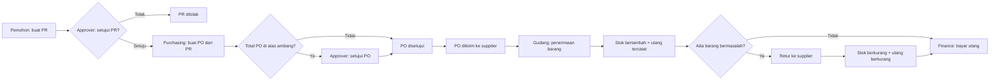

# Perencanaan Modul Purchasing dan Logistik + Role Switch

Lanjutan dari _Perencanaan Prototype Sistem Keuangan Dasar (MVP)_. Modul ini ditempel ke aplikasi yang sama (Tailwind + Alpine.js, localStorage, UI shadcn-like hitam putih, light mode), dan menghasilkan jurnal otomatis ke Chart of Accounts, Utang, Buku Besar, Neraca, dan Laba Rugi yang sudah direncanakan.

Tanggal: 11 November 2026

## 0. Keputusan desain yang perlu Anda ketahui dulu

Ada satu hal yang berbeda dari permintaan awal, dan saya pilih dengan sengaja:

- **Purchase Order (PO) tidak langsung membuat utang. Utang dicatat saat barang diterima (Penerimaan Barang).** Secara akuntansi, PO hanyalah komitmen: kita belum menerima barang, jadi belum ada kewajiban yang diakui. Jika utang dibuat saat PO disetujui, lalu PO dibatalkan atau barang tidak datang, Neraca jadi salah. Dari sisi pengguna alurnya tetap terasa "PO menghasilkan utang", karena setiap Penerimaan Barang otomatis membuat tagihan utang sesuai harga di PO.
- PO yang sudah disetujui tetap terlihat di Dashboard sebagai **Komitmen Pembelian** (di luar Neraca), supaya Anda bisa melihat perbedaan komitmen dan utang.
- **Persediaan dan Utang Usaha dikunci dari jurnal manual.** Begitu modul ini aktif, akun 1-1300 Persediaan Barang dan 2-1100 Utang Usaha hanya boleh diubah oleh modul. Tujuannya agar saldo akun selalu sama dengan rincian per barang dan per supplier.
- **Penilaian stok memakai rata-rata bergerak** (moving average). FIFO dan batch bisa jadi fase lanjutan.
- MVP memakai **satu gudang bawaan**, tetapi struktur datanya sudah menyiapkan `gudangId` agar multi gudang tinggal dibuka nanti.
- Satu tingkat persetujuan saja untuk PR dan PO.

## 1. Tujuan dan ruang lingkup

**Yang dipelajari lewat modul ini:**

- Siklus pembelian lengkap: kebutuhan (PR) → komitmen (PO) → barang datang (Penerimaan) → utang → pembayaran
- Retur pembelian dan dampaknya ke stok dan utang
- Hubungan stok fisik dengan akun Persediaan di Buku Besar (subledger dan ledger)
- Pemisahan tugas (segregation of duties) lewat role: yang meminta, menyetujui, memesan, menerima, dan membayar adalah orang berbeda

**Sengaja tidak dibuat di MVP:** penawaran harga supplier (RFQ), faktur supplier terpisah (three-way match), ongkos kirim dan diskon, PPN, multi gudang dan mutasi antar gudang, FIFO, batch dan tanggal kedaluwarsa, barcode, serta retur penjualan.

## 2. Role dan role switch

Tidak ada login. Di pojok kanan atas ada **pemilih role** (dropdown dengan avatar dan nama pengguna contoh). Memilih role mengganti menu yang tampil dan aksi yang boleh dilakukan seketika. Pilihan role disimpan di localStorage.

### 2.1 Daftar role

|Role|Pengguna contoh|Tugas utama|
|---|---|---|
|Super Admin|Admin Demo|Melihat dan mengakses semua menu; mengelola pengguna dan pengaturan; boleh melakukan semua aksi|
|Pemohon|Rina (Staf Toko)|Membuat Purchase Request|
|Approver|Pak Hadi (Manajer)|Menyetujui atau menolak PR, PO di atas ambang, dan melihat laporan|
|Purchasing|Tim Purchasing|Mengelola supplier dan harga, membuat PO dari PR, mengonfirmasi retur|
|Gudang|Anto|Menerima barang, membuat retur, mengelola stok, opname, dan pengeluaran barang|
|Finance|Tim Finance|Membayar utang, mengelola rekening, jurnal, dan laporan keuangan|

### 2.2 Matriks akses menu

Keterangan: **✓** akses penuh sesuai aksi di bagian 2.3, **L** hanya lihat, **–** menu disembunyikan.

|Menu|Super|Pemohon|Approver|Purchasing|Gudang|Finance|
|---|---|---|---|---|---|---|
|Dashboard (isi menyesuaikan role)|✓|✓|✓|✓|✓|✓|
|Master Barang|✓|L|L|✓|✓|L|
|Master Supplier|✓|–|L|✓|L|L|
|Master Kategori, Satuan, Gudang|✓|–|–|L|✓|–|
|Purchase Request|✓|✓ (milik sendiri)|✓|✓|L|–|
|Purchase Order|✓|–|✓|✓|L|L|
|Penerimaan Barang|✓|–|L|L|✓|L|
|Retur Pembelian|✓|–|L|✓|✓|L|
|Stok (posisi dan kartu stok)|✓|L|L|L|✓|L|
|Opname dan Pengeluaran Barang|✓|–|L|–|✓|L|
|Utang|✓|–|L|L|–|✓|
|Piutang|✓|–|–|–|–|✓|
|Jurnal dan Buku Besar|✓|–|–|–|–|✓|
|Chart of Accounts dan Rekening|✓|–|–|–|–|✓|
|Laporan (Neraca, Laba Rugi)|✓|–|✓|–|–|✓|
|Pengaturan dan Pengguna|✓|–|–|–|–|–|

### 2.3 Matriks aksi

|Aksi|Role yang boleh|
|---|---|
|Buat dan ajukan PR|Pemohon, Purchasing, Super|
|Setujui atau tolak PR|Approver, Super|
|Buat PO dari PR|Purchasing, Super|
|Setujui PO (jika di atas ambang)|Approver, Super|
|Tandai PO terkirim ke supplier, batalkan PO|Purchasing, Super|
|Buat Penerimaan Barang|Gudang, Super|
|Buat Retur Pembelian|Gudang, Purchasing, Super|
|Konfirmasi Retur (memposting stok dan jurnal)|Purchasing, Super|
|Opname stok dan pengeluaran barang|Gudang, Super|
|Bayar utang|Finance, Super|
|Ubah master barang dan harga supplier|Purchasing, Gudang (barang saja), Super|

### 2.4 Aturan pemisahan tugas

- Pembuat PR tidak boleh menyetujui PR yang sama, kecuali Super Admin. Jika Super melakukannya, log mencatat **"override oleh Super"**
- Pembuat PO tidak boleh menyetujui PO yang sama (kecuali Super, dengan catatan override)
- Penerimaan barang hanya oleh Gudang; Purchasing hanya bisa melihat
- Pembayaran utang hanya oleh Finance
- Setiap dokumen mencatat pembuat, penyetuju, dan waktu; semuanya terlihat di **tab Riwayat** pada dokumen

### 2.5 Cara membuatnya di Alpine.js

- `roles.js` berisi konfigurasi izin: daftar role, menu yang boleh, dan aksi yang boleh per role
- `Alpine.store('auth')` menyimpan `role` dan `user`, dengan helper `can('po', 'approve')` dan `canView('master-barang')`
- Sidebar memakai `x-show="canView('...')"`; tombol aksi memakai `x-show="can('...')"` atau `:disabled`
- Penjaga halaman: jika role tidak punya akses, tampilkan halaman **"Akses ditolak"** (bukan halaman kosong)
- Badge role di header berwarna hitam solid untuk Super, outline untuk lainnya, agar terlihat jelas saat demo
- Tooltip pada tombol yang dinonaktifkan menjelaskan alasannya, misalnya: "Hanya Approver yang dapat menyetujui PR"

## 3. Alur proses

### 3.1 Diagram alur



### 3.2 Siklus status dokumen

|Dokumen|Status (berurutan)|Keterangan|
|---|---|---|
|Purchase Request|Draft → Diajukan → Disetujui / Ditolak → Diproses (sudah jadi PO) → Selesai|PR bisa dipecah menjadi beberapa PO per supplier|
|Purchase Order|Draft → Menunggu Persetujuan → Disetujui → Dikirim → Diterima Sebagian → Diterima Penuh → Ditutup; juga Dibatalkan|Di bawah ambang, langkah "Menunggu Persetujuan" dilewati. "Ditutup" dipakai jika sisa tidak akan dikirim supplier|
|Penerimaan Barang|Draft → Diposting|Setelah diposting tidak bisa diedit; koreksi lewat Retur|
|Retur Pembelian|Draft → Dikonfirmasi|Konfirmasi memposting stok dan jurnal|
|Opname / Pengeluaran|Draft → Diposting|Sama seperti Penerimaan|

### 3.3 Aturan bisnis utama

- PR hanya bisa dijadikan PO setelah berstatus Disetujui. Jumlah di PO tidak boleh melebihi sisa PR yang belum dipesan
- PO memakai harga dari **Harga Supplier** (jika ada) atau harga beli standar barang; harga bisa diubah di PO sebelum disetujui
- Penerimaan harus merujuk ke PO. Jumlah diterima tidak boleh melebihi sisa PO (toleransi bisa diatur di Pengaturan, bawaan 0%)
- Penerimaan boleh **sebagian**; PO berpindah ke Diterima Sebagian, lalu Diterima Penuh saat semua baris terpenuhi
- Retur harus merujuk ke Penerimaan; jumlah retur tidak boleh melebihi jumlah diterima dikurangi yang sudah diretur, dan tidak boleh melebihi stok yang ada
- Barang yang sudah terlanjur keluar (terjual) tidak bisa diretur melebihi stok tersisa; sisanya diselesaikan lewat penyesuaian manual
- Pengeluaran barang tidak boleh membuat stok negatif
- Dokumen yang sudah diposting tidak dihapus, hanya dikoreksi dengan dokumen lawan

## 4. Daftar modul

|#|Modul|Isi|Role utama|
|---|---|---|---|
|M1|Role dan pengguna|Pemilih role, matriks izin, pengguna contoh, log aktivitas|Super|
|M2|Master data|Barang, kategori, satuan, supplier, harga supplier, gudang|Purchasing, Gudang|
|M3|Purchase Request|Buat, ajukan, setujui, tolak, ubah jadi PO|Pemohon, Approver|
|M4|Purchase Order|Buat dari PR atau manual, persetujuan, kirim, pantau penerimaan|Purchasing|
|M5|Penerimaan Barang|Terima sebagian atau penuh, otomatis stok masuk dan tagihan utang|Gudang|
|M6|Retur Pembelian|Retur dari penerimaan, stok keluar, utang berkurang|Gudang, Purchasing|
|M7|Stok|Posisi stok, kartu stok per barang, stok minimum, opname, pengeluaran barang|Gudang|
|M8|Integrasi Akuntansi|Jurnal otomatis, tagihan utang, rekonsiliasi stok dengan akun Persediaan|Finance|
|M9|Penomoran, pengaturan, dan alat belajar|Nomor dokumen otomatis, ambang persetujuan, skenario contoh, tooltip, ekspor dan impor|Super|

## 5. Master data

### 5.1 Master Barang

|Field|Keterangan|
|---|---|
|kode (SKU)|Unik, bisa otomatis `BRG-0001`|
|nama|Nama barang|
|kategoriId|Mengacu ke Master Kategori|
|satuanId|Satuan stok (sak, kaleng, pcs, dan seterusnya)|
|hargaBeliStandar|Harga acuan jika supplier belum punya harga khusus|
|stokMinimum|Batas peringatan stok rendah|
|kelolaStok|Ya untuk barang persediaan; Tidak untuk jasa atau barang habis pakai (langsung beban)|
|akunPersediaanId|Bawaan 1-1300 Persediaan Barang|
|aktif|Barang nonaktif tidak muncul di form baru|

Barang yang sudah dipakai di dokumen tidak boleh dihapus, hanya dinonaktifkan. Satuan tidak bisa diganti setelah ada transaksi.

### 5.2 Master Supplier

|Field|Keterangan|
|---|---|
|kode, nama|`SUP-001`, nama perusahaan atau toko|
|kontak, telepon, alamat|Informasi dasar|
|terminBayar|Jumlah hari (0 = tunai, 14, 30, dan seterusnya); dipakai menghitung jatuh tempo utang|
|aktif|Nonaktif jika tidak lagi dipakai|

Supplier otomatis tercatat sebagai **pihak (`parties`) berjenis pemasok** di modul utang, supaya tidak ada dua daftar supplier.

### 5.3 Master pendukung

|Master|Field|Fungsi|
|---|---|---|
|Kategori Barang|kode, nama|Pengelompokan di laporan stok|
|Satuan|nama, singkatan|Satu satuan per barang (konversi satuan masuk fase lanjutan)|
|Gudang|kode, nama, utama (true/false)|Satu gudang bawaan "Gudang Utama"|
|Harga Supplier|supplierId, barangId, harga, berlakuMulai|Harga terakhir per supplier; PO mengambil harga terbaru|
|Pengguna|nama, role|Pengguna contoh untuk role switch|
|Pengaturan|ambangPersetujuanPO, toleransiPenerimaan, awalanNomor|Aturan yang bisa diubah Super|

## 6. Struktur data transaksi

Semua tetap di satu objek JSON localStorage, memperluas kunci `akuntansi_mvp_v1`. Setiap dokumen punya `id`, `nomor`, `status`, `dibuatOleh`, `dibuatPada`, dan `riwayat` (daftar aksi dengan waktu dan pelaku).

|Koleksi|Field utama|Catatan|
|---|---|---|
|purchaseRequests|nomor, tanggal, pemohonId, keperluan, status, disetujuiOleh, alasanTolak|Kepala PR|
|prLines|prId, barangId, qty, catatan, qtySudahDipesan|Baris PR|
|purchaseOrders|nomor, tanggal, supplierId, prId (opsional), terminBayar, status, total, catatan|Kepala PO|
|poLines|poId, barangId, qty, harga, qtyDiterima|Subtotal = qty x harga|
|receipts|nomor, tanggal, poId, supplierId, gudangId, suratJalan, status|Kepala penerimaan|
|receiptLines|receiptId, poLineId, barangId, qty, harga, qtyDiretur|Harga disalin dari PO saat diposting|
|purchaseReturns|nomor, tanggal, receiptId, supplierId, alasan, status|Kepala retur|
|returnLines|returnId, receiptLineId, barangId, qty, harga|Harga mengikuti baris penerimaan|
|stockMovements|tanggal, barangId, gudangId, jenis, qty (positif masuk, negatif keluar), nilai, refTipe, refId|**Sumber kebenaran stok**: kartu stok dan posisi stok dihitung dari sini|
|stockAdjustments|nomor, tanggal, jenis (opname / pengeluaran), alasan, status|Kepala penyesuaian|
|stockAdjustmentLines|adjustmentId, barangId, qtySistem, qtyFisik atau qtyKeluar|Selisih dihitung otomatis|
|activityLog|waktu, userId, role, aksi, dokumen, catatan|Termasuk catatan override Super|

Tambahan pada koleksi yang sudah ada di dokumen akuntansi:

|Koleksi|Tambahan|Alasan|
|---|---|---|
|accounts|dikunci (true untuk 1-1300 dan 2-1100)|Mencegah jurnal manual merusak keselarasan stok dan utang|
|invoices|sumber (manual / penerimaan), refId|Tagihan utang dari Penerimaan menunjuk ke dokumennya|
|payments|jenis (bayar / retur)|Retur mengurangi sisa tagihan tanpa uang keluar|
|journals|sumber bertambah: penerimaan, retur, stok|Penelusuran dari jurnal ke dokumen asal|

### Penomoran dokumen

Format `PR-2026-0001`, `PO-2026-0001`, `GR-2026-0001`, `RTN-2026-0001`, `ADJ-2026-0001`. Penghitung per jenis dan per tahun disimpan di `settings`. Nomor tidak dipakai ulang walau dokumen dibatalkan.

## 7. Perhitungan stok (rata-rata bergerak)

Setiap pergerakan stok menyimpan **qty** dan **nilai**. Dari situ:

```
Stok barang      = jumlah qty semua movement barang itu
Nilai persediaan = jumlah nilai semua movement barang itu
Harga rata-rata  = Nilai persediaan / Stok
```

|Kejadian|Qty movement|Nilai movement|
|---|---|---|
|Penerimaan|+ qty diterima|+ qty x harga PO|
|Retur ke supplier|- qty retur|- qty x harga baris penerimaan asal|
|Pengeluaran barang|- qty keluar|- qty x harga rata-rata saat itu (dibulatkan ke rupiah)|
|Opname selisih lebih|+ selisih|+ selisih x harga rata-rata|
|Opname selisih kurang|- selisih|- selisih x harga rata-rata|

Karena nilai disimpan sebagai angka bulat rupiah, total nilai persediaan seluruh barang selalu sama persis dengan saldo akun 1-1300. Selisih pembulatan tidak dibawa ke mana-mana.

## 8. Integrasi akuntansi (jurnal otomatis)

|Kejadian|Debit|Kredit|Catatan|
|---|---|---|---|
|PO disetujui|(tidak ada jurnal)|(tidak ada jurnal)|Hanya komitmen, tampil di Dashboard|
|Penerimaan diposting|Persediaan Barang (1-1300)|Utang Usaha (2-1100)|Sebesar jumlah qty x harga PO; membuat tagihan utang dengan jatuh tempo = tanggal + termin supplier|
|Retur dikonfirmasi|Utang Usaha (2-1100)|Persediaan Barang (1-1300)|Mengurangi sisa tagihan asal; jika tagihan sudah lunas, menjadi **Kredit Supplier** yang bisa dipotong dari tagihan berikutnya|
|Bayar utang (halaman Utang yang sudah ada)|Utang Usaha (2-1100)|Kas atau Bank|Finance memilih rekening|
|Pengeluaran barang (penjualan atau pemakaian)|Harga Pokok Penjualan (5-1100)|Persediaan Barang (1-1300)|Sebesar nilai rata-rata; di sinilah HPP lahir dari stok|
|Opname selisih kurang|Beban Selisih Persediaan (5-1200)|Persediaan Barang (1-1300)|Barang hilang atau rusak|
|Opname selisih lebih|Persediaan Barang (1-1300)|Beban Selisih Persediaan (5-1200)|Mengurangi beban|

**Akun baru di Chart of Accounts:** `5-1200 Beban Selisih Persediaan` (Beban, saldo normal debit). Seed akun menjadi 24.

### Rekonsiliasi (alat belajar utama)

Di Dashboard dan halaman Stok ada kartu **"Stok vs Buku Besar"**:

- Nilai persediaan dari kartu stok (jumlah semua movement) dibandingkan dengan saldo akun 1-1300
- Utang per supplier (jumlah sisa tagihan) dibandingkan dengan saldo akun 2-1100
- Keduanya harus selisih 0. Jika tidak, tampilkan peringatan dan daftar dokumen yang mencurigakan

### Dampak ke dokumen akuntansi sebelumnya

- Skenario 10 transaksi lama: transaksi 3 (beli kredit), 4, dan 5 (jual dengan HPP) memakai akun yang sekarang dikunci. Pada versi gabungan, transaksi itu diganti oleh PO + Penerimaan dan Pengeluaran Barang
- Halaman Utang yang sudah direncanakan tidak dibangun ulang; tagihan dari Penerimaan muncul di sana otomatis
- Pemilih role berlaku untuk **seluruh aplikasi**, termasuk menu akuntansi lama (lihat matriks 2.2)

## 9. Halaman dan fitur

|#|Halaman|Isi dan fitur|
|---|---|---|
|1|Dashboard|Kartu menyesuaikan role. Approver: PR dan PO menunggu persetujuan. Purchasing: PO belum diterima, komitmen pembelian. Gudang: stok di bawah minimum, penerimaan hari ini. Finance: utang jatuh tempo, saldo rekening. Semua: kartu "Stok vs Buku Besar"|
|2|Master Barang|Tabel, pencarian, filter kategori, tambah dan ubah lewat dialog, kolom stok saat ini|
|3|Master Supplier|Tabel supplier, termin, dan tab Harga Supplier per barang|
|4|Master Kategori, Satuan, Gudang|Tiga tab dalam satu halaman|
|5|Purchase Request|Daftar dengan filter status; form PR dengan baris barang; tombol Ajukan; untuk Approver tombol Setujui dan Tolak (alasan wajib); tombol Buat PO pada PR yang disetujui|
|6|Purchase Order|Daftar dan form; supplier dan harga terisi otomatis; ringkasan total; tab Penerimaan dan Retur terkait; bilah progres penerimaan per baris|
|7|Penerimaan Barang|Pilih PO yang masih terbuka, isi qty diterima per baris (default sisa PO), nomor surat jalan; pratinjau jurnal sebelum diposting|
|8|Retur Pembelian|Pilih penerimaan, isi qty retur dan alasan, pratinjau dampak stok dan utang sebelum dikonfirmasi|
|9|Stok|Tab Posisi Stok (qty, nilai, rata-rata, peringatan minimum), tab Kartu Stok per barang (masuk, keluar, saldo berjalan, klik baris untuk loncat ke dokumen)|
|10|Opname dan Pengeluaran|Form hitung fisik dan form pengeluaran barang; pratinjau jurnal|
|11|Utang|Halaman yang sudah ada, ditambah filter supplier dan kolom dokumen asal (klik ke Penerimaan)|
|12|Pengaturan dan Pengguna|Ambang persetujuan PO, toleransi penerimaan, awalan nomor, daftar pengguna dan role, tombol muat skenario dan reset|

Setiap dokumen punya tab **Riwayat** yang menampilkan siapa melakukan apa dan kapan, termasuk catatan override Super.

## 10. Skenario belajar purchasing

Skenario berdiri sendiri (bukan lanjutan skenario 10 transaksi lama). Prasyarat: modal awal sudah disetor 50.000.000 ke Bank BCA. Supplier A bertermin 30 hari. Barang: Semen 50 kg (sak) harga 65.000 dan Cat tembok (kaleng) harga 150.000.

|#|Peristiwa (role yang melakukan)|Dampak|
|---|---|---|
|1|Rina (Pemohon) membuat PR: Semen 100 sak, Cat 20 kaleng, lalu mengajukan|PR Diajukan|
|2|Pak Hadi (Approver) menyetujui PR|PR Disetujui|
|3|Purchasing membuat PO ke Supplier A: Semen 6.500.000, Cat 3.000.000, total 9.500.000. Karena di atas ambang 5.000.000, Pak Hadi menyetujui PO|PO Disetujui; tidak ada jurnal; Komitmen 9.500.000|
|4|Anto (Gudang) menerima Semen 60 sak dan Cat 20 kaleng|Stok masuk; jurnal Persediaan 6.900.000 / Utang Usaha 6.900.000; PO Diterima Sebagian (Semen sisa 40)|
|5|Anto menerima sisa Semen 40 sak|Jurnal Persediaan 2.600.000 / Utang Usaha 2.600.000; PO Diterima Penuh; total utang 9.500.000|
|6|Anto membuat retur 5 kaleng Cat rusak (750.000); Purchasing mengonfirmasi|Jurnal Utang Usaha 750.000 / Persediaan 750.000; stok Cat 15; sisa utang 8.750.000|
|7|Finance membayar utang sebagian 5.000.000 dari Bank BCA|Jurnal Utang Usaha 5.000.000 / Bank BCA 5.000.000; sisa utang 3.750.000|
|8|Anto mengeluarkan Semen 30 sak untuk penjualan|Jurnal HPP 1.950.000 / Persediaan 1.950.000; stok Semen 70|

**Hasil yang harus muncul di aplikasi:**

|Pemeriksaan|Nilai yang benar|
|---|---|
|Stok Semen|70 sak (nilai 4.550.000)|
|Stok Cat|15 kaleng (nilai 2.250.000)|
|Nilai persediaan dari kartu stok|6.800.000|
|Saldo akun 1-1300 Persediaan Barang|6.800.000 (sama dengan kartu stok, selisih 0)|
|Saldo akun 2-1100 Utang Usaha|3.750.000 (sama dengan sisa tagihan Supplier A)|
|Saldo Bank BCA|50.000.000 - 5.000.000 = 45.000.000|
|HPP di Laba Rugi|1.950.000|
|Komitmen pembelian di Dashboard|0 (PO sudah Diterima Penuh)|

Pertanyaan latihan:

- Mengapa jurnal baru muncul saat Penerimaan, bukan saat PO disetujui?
- Setelah retur, mengapa utang berkurang tetapi tidak ada uang yang keluar dari Bank?
- Jika retur dilakukan setelah utang lunas, apa yang terjadi pada saldo Utang Usaha?
- Mengapa HPP baru muncul di Laba Rugi saat barang keluar, bukan saat dibeli?
- Coba ganti role ke Pemohon: menu apa saja yang hilang, dan mengapa Finance tidak bisa menerima barang?

## 11. Struktur file tambahan

```text
akuntansi-mvp/
  js/
    roles.js            daftar role, matriks menu dan aksi, pengguna contoh
    auth.js             Alpine.store('auth'): role aktif, can(), canView()
    master.js           CRUD barang, supplier, kategori, satuan, gudang, harga supplier
    purchasing.js       PR, PO, status, validasi, persetujuan
    receiving.js        penerimaan dan retur; membuat movement, tagihan, jurnal
    inventory.js        stockMovements, posisi stok, kartu stok, opname, pengeluaran
    numbering.js        penomoran dokumen
    reconcile.js        rekonsiliasi stok vs Buku Besar dan utang vs Buku Besar
    seed-purchasing.js  master data contoh + skenario bagian 10
```

Aturan arsitektur: modul purchasing **tidak menulis jurnal sendiri**. Ia memanggil `ledger.js` (`buatJurnal(...)`) dengan sumber dan refId, sehingga validasi debit sama dengan kredit tetap di satu tempat.

## 12. Tahapan pengerjaan

- [x] **P0, role switch:** `roles.js`, `auth.js`, pemilih role di menu kiri, penjaga halaman, halaman Akses ditolak, aplikasikan ke menu akuntansi yang sudah ada
- [x] **P1, master data:** barang, supplier, kategori, satuan, gudang, harga supplier, penomoran, pengaturan
- [x] **P2, Purchase Request:** form, ajukan, setujui atau tolak, riwayat, log aktivitas
- [x] **P3, Purchase Order:** buat dari PR dan manual, ambang persetujuan, kirim, batalkan, tutup
- [x] **P4, Penerimaan dan stok masuk:** penerimaan sebagian atau penuh, `stockMovements`, tagihan utang, jurnal otomatis, kunci akun 1-1300 dan 2-1100
- [x] **P5, Retur pembelian:** retur dari penerimaan, potong invoice atau ganti barang, pengurangan tagihan, Piutang Supplier, penerimaan pengganti
- [ ] **P6, Halaman Stok:** posisi stok, kartu stok, stok minimum, opname, pengeluaran barang dengan HPP
- [ ] **P7, integrasi dan alat belajar:** kartu rekonsiliasi, Dashboard per role, skenario bagian 10, tooltip glosarium purchasing, ekspor dan impor, reset

**Kriteria selesai:** skenario bagian 10 dijalankan dengan berganti role sesuai pelaku, lalu seluruh tabel hasil di bagian 10 cocok, dan kartu rekonsiliasi menunjukkan selisih 0.

**Saran dengan AI agent:** kerjakan satu tahap per sesi, dan di akhir tiap tahap jalankan bagian skenario yang relevan. Tahap P4 adalah yang paling rawan (stok, utang, dan jurnal harus konsisten), jadi minta agent menulis fungsi uji sederhana di konsol: setelah skenario, jalankan `cekRekonsiliasi()` yang harus mengembalikan selisih 0.

## 13. Tambahan istilah untuk tooltip (`glosarium.js`)

|Istilah|Teks penjelasan|
|---|---|
|Purchase Request (PR)|Permintaan internal untuk membeli barang. Belum mengikat ke supplier dan belum berdampak ke keuangan.|
|Purchase Order (PO)|Pesanan resmi ke supplier. Mengikat kita untuk membeli, tetapi belum menjadi utang sampai barang diterima.|
|Komitmen pembelian|Total PO yang sudah disetujui tetapi barangnya belum datang. Tidak masuk Neraca.|
|Penerimaan Barang|Bukti barang sudah sampai di gudang. Saat diposting, stok bertambah dan utang tercatat.|
|Retur pembelian|Pengembalian barang ke supplier. Stok berkurang dan utang ke supplier ikut berkurang.|
|Termin bayar|Jumlah hari yang diberikan supplier untuk membayar sejak barang diterima. Menentukan tanggal jatuh tempo.|
|Kredit supplier|Saldo lebih bayar ke supplier akibat retur setelah tagihan lunas. Bisa dipotong dari tagihan berikutnya.|
|Stok minimum|Batas jumlah stok. Di bawah angka ini barang ditandai perlu dipesan ulang.|
|Kartu stok|Riwayat semua barang masuk dan keluar untuk satu barang beserta saldo berjalan.|
|Rata-rata bergerak|Cara menilai stok: harga rata-rata dihitung ulang setiap ada barang masuk, dan dipakai saat barang keluar.|
|Opname|Menghitung stok fisik lalu mencocokkannya dengan stok di sistem. Selisihnya dicatat sebagai beban atau pengurang beban.|
|Stok vs Buku Besar|Pemeriksaan bahwa nilai stok di kartu stok sama dengan saldo akun Persediaan. Selisih berarti ada data yang tidak sinkron.|
|Override oleh Super|Super Admin melakukan aksi yang biasanya dilarang bagi perannya, misalnya menyetujui PR buatannya sendiri. Dicatat di riwayat.|

## 14. Fase lanjutan

Faktur supplier terpisah dan pencocokan tiga arah (PO, penerimaan, faktur), ongkos kirim dan diskon pembelian, PPN masukan, multi gudang dan mutasi antar gudang, konversi satuan, FIFO atau batch dan kedaluwarsa, RFQ dan perbandingan harga supplier, retur penjualan, serta pindah penyimpanan ke SQLite atau Supabase dengan login sungguhan.